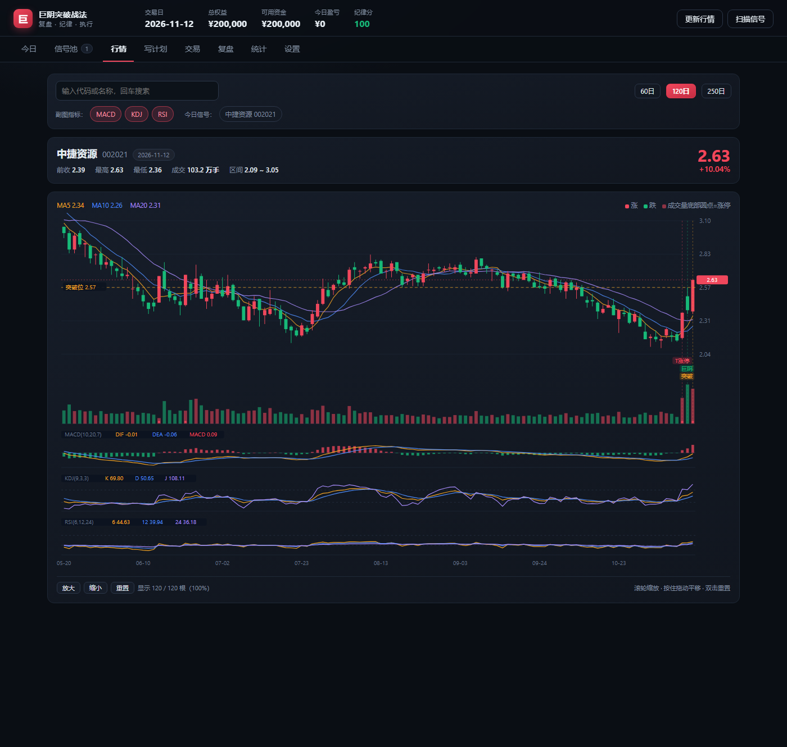

# 巨阴突破战法 · 复盘纪律系统

一个**不靠意志力**的短线交易纪律系统。

它只做五件事：

1. **机器选股** —— 按你写死的规则扫描全市场，不给你临盘自由发挥的空间
2. **画图看形** —— 蜡烛图 + 成交量 + 均线，把 T 日、巨阴、突破位直接标在图上
3. **强制计划** —— 没有计划，系统不允许记录任何一笔买入
4. **硬性闸门** —— 追高、超仓、无止损、盈亏比不够、连亏冷静期，直接拦住
5. **代价可视化** —— 用你自己的数据，算出"破戒"到底亏了多少钱

---

## 一、它到底解决什么问题

你说"操作起来总是没有纪律性"。纪律不是性格问题，是**流程问题**。人的四个漏洞：

| 漏洞 | 具体表现 | 系统的解法 |
|---|---|---|
| 选股随意 | 盘中看到异动就上，事后才发现形态不对 | 收盘后扫描，信号池是封闭集合，池外不交易 |
| 计划缺位 | 先买，再想理由和止损 | 无计划 = 记录不了成交（硬拦截） |
| 执行走形 | 追高 2 个点、多买两手、止损往下挪 | 价格上限/股数/止损三道硬校验，超了 422 |
| 复盘不落地 | 亏了就算了，下次照旧 | 不复盘扣 20 分，错误标签自动统计 |

**关键设计**：想违规不是不行，但必须**先去改计划，留下痕迹**。系统不假装能阻止你手滑，它只保证你滑了之后无法假装没滑。

---

## 二、战法规则（可参数化）

```
T   日：涨停（收盘即最高价，涨幅达板块上限）
T+1 日：高开（≥1%）+ 收阴（收盘 < 开盘）
        且 收盘价 > T 日开盘价          ← 多头结构未破坏
突破日：T+1 之后 10 个交易日内，第一次「涨停收盘突破 T+1 最高价」的那天
        必须同时放量（≥1.5 倍 5 日均量）
        ★ 第一次突破无量 = 形态作废，后面某天再放量涨停也**不算**
买点  ：突破日的下一个交易日开盘
```

那条 ★ 是被反复踩坑后才补上的：**突破只有第一次算数**。第一次涨停突破如果没放量，说明资金不认，形态已经被消耗掉了；第二天再放量涨停，位置已经高一截，追进去就是接力别人的获利盘，不是战法的买点。系统会把这类票直接标成「突破无量·作废」，不进信号池。

板块涨停幅度自动识别：主板 10%、创业板/科创板 20%、北交所 30%、主板 ST 5%。

参数在「设置」页可改，改完下次扫描立即生效。

### 看图

点任意股票名，或在「行情」页搜代码，都会打开这张图：



**主图**：蜡烛 + 成交量 + MA5/10/20，关键日期和价位直接标在图上。

- **T涨停 / 巨阴 / 突破** —— 形态的三个关键日，竖向虚线，重叠时自动分行
- **突破位** —— T+1 阴线的最高价，水平虚线；收盘站上它才算突破
- **成交量底部圆点** —— 这一天涨停

**副图**：MACD(10,20,7)、KDJ(9,3,3)、RSI(6,12,24)，全部按通达信口径计算，可单独开关。每个副图左上角实时显示当前值。

指标参数集中在 `zffp/config.py` 的 `INDICATOR_PARAMS`，改一处，计算和标题同步生效。

**交互**：

| 操作 | 效果 |
|---|---|
| 滚轮 | 以光标位置为锚点缩放 |
| 按住拖动 | 左右平移 |
| 双击 / 重置 | 回到最近 120 根 |
| 顶部 60/120/250 日 | 切换取数窗口 |
| 悬停 | 显示当天开高低收、涨跌幅、成交量，以及三个指标的值 |

举个真实例子（002021 中捷资源）：10-28 涨停、10-29 巨阴收在 2.09 上方，随后横盘一个多月，11-12 放量 1.9 倍涨停收 2.63，站上 2.57 的突破位——这才是有效突破，买点顺延到 11-13。

反例（603135 中重科技）：11-11 就涨停突破 9.06 了，但量比只有 1.38，不够。按新规则，**这一笔直接作废**，11-12 那根放量 5.51 倍的涨停也不再算信号。

---

## 三、快速开始
```bash
# 1. 装依赖（只有 3 个）
pip install -r requirements.txt

# 2. 首次拉全市场行情（约 2 分钟，4605 只 × 260 根日线）
python run.py update -f

# 3. 启动
python run.py
# 打开 http://127.0.0.1:8777
```

Windows 用户可直接双击 `启动.bat`。

**首次进入后**：点右上角「扫描信号」，然后看「今日」页。没有可下手的票是正常结果——战法大部分时候在等。

### 数据库怎么办

`data/zffp.db`（约 130 MB）**不在仓库里**——超过 GitHub 的 100 MB 单文件限制。

| 场景 | 做法 |
|---|---|
| 克隆后第一次用 | 直接跑 `python run.py update -f`，**约 2 分钟**重建（空库会自动建表） |
| 增量更新 | `python run.py update`，只补最后几根，几秒钟 |
| 换机器不想重拉 | 直接拷贝 `data/zffp.db` 这一个文件，它是自包含的 |
| 想分发数据 | 压缩后约 **35 MB**，可自行打包（`gzip` 即可） |

数据全部来自腾讯/新浪的公开行情接口，不需要注册、不需要 token，**任何时候都能重建**。

---

## 四、每天怎么用（盘后 10 分钟）

**15:00 后**

1. 点「更新行情」→ 自动增量拉取 + 扫描
2. 打开「今日」页，看四个流程项是否全绿
3. 若有「今天可以买」的信号 → 点「写计划」
   - 系统自动算出：买多少股、止损放哪、目标价多少、盈亏比够不够
   - 填一句买入理由（少于 10 字会被拒绝）
   - 闸门全绿才能点「锁定计划」
4. 第二天开盘：**只买计划内的票，价格高于上限就不买**
5. 收盘后「记录成交」→ 持仓自动进入监控，破止损会红字警告
6. 卖出后 24 小时内必须复盘，否则当日纪律分 -20

**每个周末**：看「统计」页的 **合规 vs 违规** 对比。这张表是唯一能说服自己的东西。

---

## 五、系统会拦住你的 13 种情况

**写计划时**（后端 422 + 前端红字）

| 代码 | 拦截原因 |
|---|---|
| `SIGNAL_MISSING` | 没有信号来源，不接受「临时觉得能涨」 |
| `SIGNAL_NOT_TRIGGERED` | 信号还没突破，提前埋伏是另一种战法 |
| `BUY_DATE_MISMATCH` | 买点只有一天，错过就不做 |
| `CHASE` | 计划价高于突破日收盘 8% 以上 = 追高 |
| `NO_STOP` / `STOP_ABOVE_PRICE` | 没止损，或止损高于买价 |
| `STOP_TOO_FAR` | 止损幅度 > 8%（太远的止损你不会执行） |
| `RR_LOW` | 盈亏比 < 2:1 |
| `THESIS_SHORT` | 买入理由 < 10 字 |
| `OVERSIZE` | 股数超过「单笔风险 2%」算出的上限 |
| `PLAN_CAP` | 当日计划已满 3 个 |
| `POSITION_CAP` | 同时持仓已满 3 只 |
| `COOLDOWN` | 连亏 3 笔 → 冷静 3 个交易日 |
| `DAILY_STOP` | 当日亏损达 3%，今天收工 |

**记录成交时**：`NO_PLAN`（无计划）、`OVER_PRICE`（超出计划价）、`DATE_MISMATCH`（不是计划那天）、`OVERSIZE`。

**卖出时**：`STOP_DELAY`（早该止损却拖了 N 天，会写进违规统计）。

---

## 六、统计口径

- **期望值** = 总盈亏 / 笔数。这是唯一重要的数字，胜率不是。
- **合规 vs 违规**：按每笔的违规标签分组，对比胜率与期望值。样本到 10 笔以上就有参考意义。
- **战法体检**：只看信号本身买入后的 1/3/5 日表现，**不管你有没有做**。这是战法的"基础概率"。
  > 当前数据（2026-11-13 回看 37 个信号）：D+3 平均 **+3.50%**、胜率 55.6%，平均最大浮亏 **-7.33%**。
  >
  > 对比加上「第一次突破必须放量」规则之前的同口径数据：D+3 只有 +2.15%、胜率 51.2%、浮亏 -8.45%。
  > 一条规则把胜率抬了 4 个点、期望值抬了 60%，**说明"突破无量就作废"这个判断是对的**。
  > 但样本只有 37 个，别把它当定律——继续攒数据。
- **纪律分**：每日 100 分起，无计划 -40、追价 -25、止损拖延 -30、冷静期开仓 -40、未复盘 -20。与盈亏无关，只看动作。

---

## 七、项目结构

```
zffp/
├── run.py                 启动入口（serve / update / scan / doctor）
├── requirements.txt
├── 启动.bat
├── zffp/
│   ├── config.py          战法参数 + 风控参数（默认值都在这里）
│   ├── strategy.py        形态识别（纯函数，26 项单测覆盖）
│   ├── db.py              SQLite 存储
│   ├── datafeed.py        腾讯前复权 / 新浪 / 东财 / CSV 导入
│   ├── discipline.py      纪律引擎（闸门 + 评分）★核心
│   ├── scanner.py         扫描编排
│   ├── analytics.py       统计与战法体检
│   └── api.py             HTTP 接口
├── web/                   前端（原生 JS，无构建）
│   ├── index.html
│   ├── style.css
│   ├── chart.js           K 线图渲染（纯 SVG，无依赖）
│   └── app.js
├── tests/                 单测
└── data/zffp.db           本地数据库
```

---

## 八、数据源

| 用途 | 主源 | 备源 |
|---|---|---|
| 日线（前复权） | 腾讯 `web.ifzq.gtimg.cn` | 新浪（不复权） |
| 股票列表 | 新浪 `Market_Center` | 东方财富 |

- 全部免 token，无需注册。
- 数据落本地 SQLite，之后扫描/复盘/统计**完全离线**，断网也能用。
- **盘中保护**：15:00 前自动剔除当日未收盘 K 线，避免用半根 K 线判形态。
- 自备数据：`POST /api/import/csv`，或把 `600000.csv`（列名支持中英文）放进目录后导入。

---

## 九、常用命令

```bash
python run.py              # 启动网页
python run.py update       # 增量更新行情
python run.py update -f    # 全量重拉
python run.py scan         # 只跑扫描
python run.py doctor       # 自检（覆盖度/信号数/战法体检）
python -m pytest tests -q  # 跑单测
```

---

## 十、一句提醒

系统能拦住你的手，拦不住你的仓位。**参数是你自己定的，别把 `risk_per_trade_pct` 改成 10% 再来怪系统没用。**

先按默认值跑 20 笔，再看统计页。
